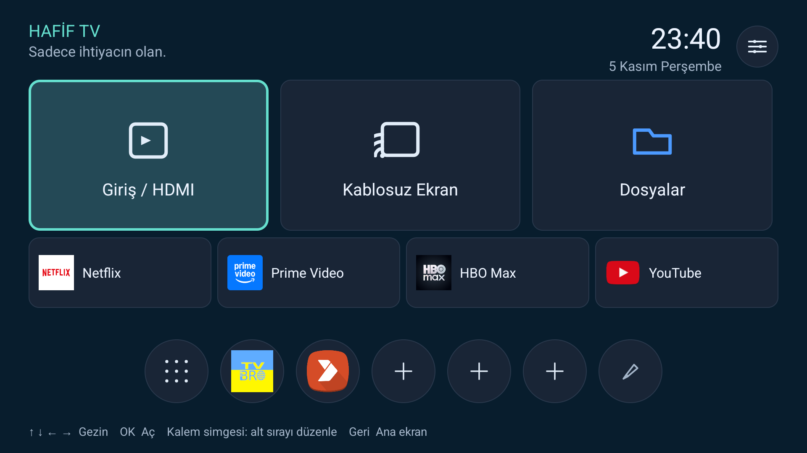

# Hafif TV

950 MB RAM'li bir Android TV projeksiyon cihazı için yazılmış, **tek Activity'li, sıfır bağımlılıklı** ana ekran (launcher).

Cihazın stok arayüzü (LuminaOS) 60 MB PSS kullanıp 1,2 saniyede açılıyordu. Bu launcher aynı işi **30 MB PSS** ve **0,63 saniyede** yapıyor — üstelik daha az yer kaplıyor: 31,6 MB yerine 382 KB.



## Neden yazıldı

Cihaz: ADT-3 (Askey), Allwinner `sun50iw15p1`, Android 14 (SDK 34), **951 MB RAM**, 1920x1080 @320dpi, yalnız `armeabi-v7a`, root yok (`ro.secure=1`).

Bu sınıf cihazlarda OEM launcher'ı:

- onlarca servisi ve reklam/telemetri kütüphanesini birlikte başlatıyor,
- uygulama ikonlarını her açılışta paket yöneticisinden yeniden çözüyor,
- kullanıcının ihtiyacı olmayan 8 ayrı ayar ekranını ana ekrana gömüyor.

Bunun yerine ihtiyaç duyulan şey küçük, öngörülebilir ve kumandayla tam çalışan bir menü.

## Ne yapar

- **3 büyük kart** — Giriş/HDMI, Kablosuz Ekran, Dosyalar
- **4 hızlı uygulama kutusu** — Netflix (tarayıcıda), Prime Video, HBO Max, YouTube
- **5 düzenlenebilir yuvarlak** — istediğin uygulamayı ata, uzun OK ile değiştir
- **Kalem yuvarlağı** — "Alt sırayı düzenle" ekranı: 5 yuvarlağı tek tek değiştir veya temizle
- **Ayarlar** — sağ üstte yuvarlak; cihaz ayarları, TV ayarları, ağ, bluetooth, uygulamalar, duvar kağıdı, projeksiyon, güç
- **Odak testi** — Ayarlar → Projeksiyon içinde üç desenli tam ekran referans: odak yıldızı, punto merdiveni, ızgara/kenar çizgileri. Manuel odak halkasını ayarlamak için; OK ile desen değişir, Geri ile dönülür.
- Uygulama çekmecesi: tüm LEANBACK/LAUNCHER uygulamaları, alfabetik (Türkçe sıralama), uzun OK ile favori

## Ölçümler

Aynı cihazda, 3 kez soğuk başlatma, medyan:

| | LuminaOS (stok) | Hafif TV |
|---|---|---|
| PSS | 60,2 MB | **30,0 MB** |
| RSS | 134,1 MB | **98,6 MB** |
| Soğuk açılış | 1207 ms | **629 ms** |
| APK boyutu | 31,6 MB | **382 KB** |
| Java + native | 35,3 MB | **17,8 MB** |

Not: soğuk açılış "process cold" — uygulama süreci öldürülüp yeniden başlatılarak ölçüldü, cihaz reseti değil.

## Neden bu kadar küçük

- **Tek Activity**, tek layout, sıfır kütüphane (AndroidX yok, RecyclerView yok, Compose yok).
- **Simge rasterleme yok**: büyük APK'lardan (SystemUI, TvSettings, 30 MB'lık OEM uygulaması) ikon çekmek 32 MB kaynak haritalamasına yol açıyordu. Bunun yerine bu ikonlar cihazda bir kez 256x256 PNG olarak alınıp pakete gömüldü — toplam ~450 KB.
- **Grafikler kodla çiziliyor** (`Canvas`/`Path`): HDMI, yansıtma, klasör, ızgara, kaydırıcı, artı, kalem ikonları tek tek çizildi; hiçbir varlık dosyası yok.
- **Animasyon yok**, paylaşılan öğe geçişi yok, arka planda servis yok, izin yok, telemetri yok.

## Derleme

Gereksinimler:

- JDK 17
- Android SDK: `platforms;android-34` + `build-tools;34.0.0`
- PowerShell

```powershell
# AndroidManifest.xml, res/ ve src/ aynı dizinde
./build.ps1
# çıktı: out/LiteTV-signed.apk
```

`build.ps1` sırasıyla `aapt2` → `javac` → `d8` → `zipalign` → `apksigner` çağırır; Gradle kullanmaz.

İlk derlemeden önce bir debug keystore üret:

```powershell
keytool -genkeypair -keystore keys/debug.keystore -alias androiddebugkey `
  -storepass android -keypass android -keyalg RSA -keysize 2048 -validity 10000 `
  -dname "CN=Android Debug,O=Android,C=US"
```

## Kurulum

```bash
adb install -r out/LiteTV-signed.apk
adb shell cmd package set-home-activity org.mehmet.litetv/.MainActivity
```

Geri dönmek için:

```bash
adb shell cmd package set-home-activity <stok-launcher>/.<AnaActivity>
```

## Bilinen sınırlar

Bu bir **kullanıcı arayüzü** projesidir; stok sistem uygulamasının yerini tamamen alamaz:

- **Sistem imzası gerektiren ekranlar** (projeksiyon keystone, görüntü modu, güç yönetimi) OEM uygulamasının içinde `android.uid.system` ile çalışır. Normal bir APK bunları açamaz; bu yüzden o kartlar OEM'in kendi ayar ızgarasına yönlendirir. Sahte slider/switch konmadı.
- **Widevine L3**: cihazda L1 keybox yok; Netflix gibi uygulamalar "cihaz desteklenmiyor" diyebilir.
- **HDMI** kaynağı `awlivetv` bileşeniyle değiştirilir; kaynak boşsa siyah ekran görülür, HOME tuşu geri döndürür.
- Gömülü uygulama ikonları cihazdan alınmış anlık görüntülerdir; uygulama güncellenince eski ikon görünebilir.

## Sorumluluk reddi

Bu yazılım **olduğu gibi** sunulmuştur. Cihazınızda oluşabilecek her türlü sonuç — veri kaybı, açılmayan cihaz, garanti kaybı, ayarların bozulması, üçüncü taraf uygulamaların çalışmaması — kullanıcının sorumluluğundadır. Geliştirici hiçbir sorumluluk kabul etmez. Yüklemeden önce stok launcher'ı geri yükleme yolunuzu bildiğinizden emin olun.

Bu proje hiçbir üreticiyle bağlantılı değildir; marka adları yalnızca tanımlama amacıyla geçer.

## Lisans

MIT — bkz. [LICENSE](LICENSE).
