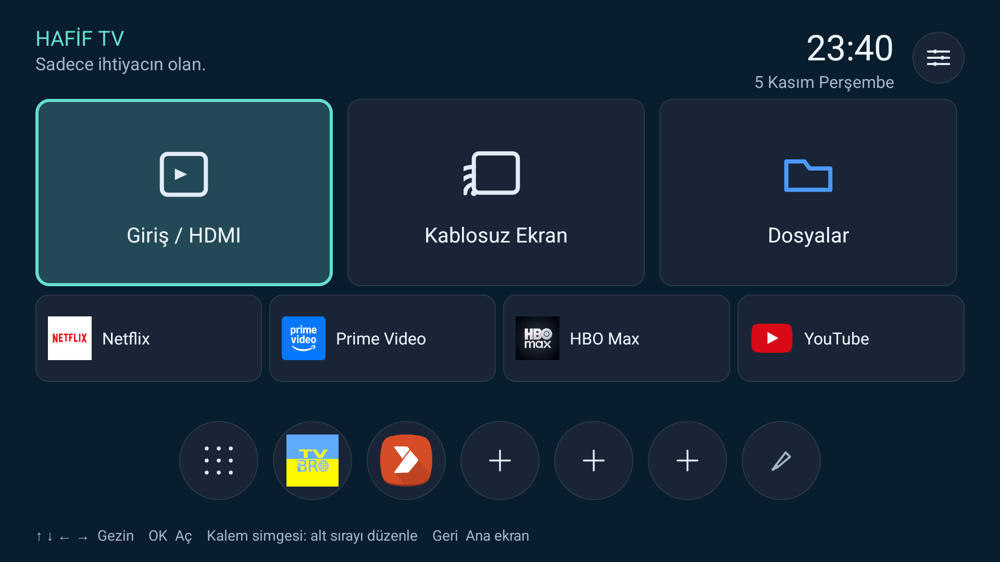

# Hafif TV

**English** · [Türkçe](README.tr.md)

[](LICENSE)
[-3DDC84.svg)](#build)
[](release/LiteTV-signed.apk)

A **single-Activity, zero-dependency** home launcher written for low-memory (950 MB RAM) Android TV projectors.

The stock OEM launcher (LuminaOS) used 60 MB PSS and took 1.2 seconds to cold-start. Hafif TV does the same job in **30 MB PSS** and **0.63 seconds**, while shrinking the APK from 31.6 MB down to **382 KB**.



## Why it exists

Target device: ADT-3 (Askey), Allwinner `sun50iw15p1`, Android 14 (SDK 34), **951 MB RAM**, 1920x1080 @320dpi, `armeabi-v7a` only, non-rooted (`ro.secure=1`).

On this class of hardware, stock OEM launchers typically:

- start dozens of background services and ad/telemetry SDKs at boot,
- re-resolve app icons from `PackageManager` on every launch,
- embed redundant settings screens directly into the home UI.

What these devices actually need is a small, predictable, D-pad-friendly launcher.

## What it does

- **3 large cards** — Input/HDMI, Wireless Display, Files
- **4 quick-launch tiles** — Netflix (browser), Prime Video, HBO Max, YouTube
- **5 customizable circles** — assign any installed app, long-press OK to change
- **Edit button** — dedicated "Edit bottom row" view to reassign or clear each slot
- **Settings** — top-right quick button for device settings, TV settings, network, Bluetooth, apps, wallpaper, projection, and power
- **Focus test** — built into Settings → Projection: 3 full-screen calibration patterns (focus star, font-size ladder, alignment grid) for tuning a manual projector focus ring (OK cycles patterns, Back exits)
- **App drawer** — all `LEANBACK`/`LAUNCHER` apps sorted alphabetically, long-press OK to pin

## Benchmarks

Measured on the same device across 3 cold starts (median):

| Metric | LuminaOS (stock) | Hafif TV |
|---|---:|---:|
| PSS | 60.2 MB | **30.0 MB** |
| RSS | 134.1 MB | **98.6 MB** |
| Cold start | 1207 ms | **629 ms** |
| APK size | 31.6 MB | **382 KB** |
| Java + native | 35.3 MB | **17.8 MB** |

*Note: "Cold start" means killing the app process and relaunching it, not a full device reboot.*

## Why it is so small

- **Single Activity**, single layout, zero third-party libraries (no AndroidX, no RecyclerView, no Jetpack Compose).
- **No runtime icon rasterization**: pulling icons from large system APKs (SystemUI, TvSettings, 30 MB OEM launcher) caused ~32 MB of resource mapping overhead. Instead, those icons were extracted once as 256x256 PNGs and bundled (~450 KB total).
- **Procedural vector graphics** (`Canvas`/`Path`): HDMI, cast, folder, grid, slider, plus, and edit icons are drawn directly in code.
- **No animations**, no shared-element transitions, no background services, no extra permissions, no telemetry.

## Build

Requirements:

- JDK 17
- Android SDK: `platforms;android-34` + `build-tools;34.0.0`
- PowerShell

```powershell
# AndroidManifest.xml, res/ and src/ in the same directory
./build.ps1
# output: out/LiteTV-signed.apk
```

`build.ps1` invokes `aapt2` → `javac` → `d8` → `zipalign` → `apksigner` directly — no Gradle required.

Before the first build, generate a debug keystore:

```powershell
keytool -genkeypair -keystore keys/debug.keystore -alias androiddebugkey `
  -storepass android -keypass android -keyalg RSA -keysize 2048 -validity 10000 `
  -dname "CN=Android Debug,O=Android,C=US"
```

## Install

```bash
adb install -r out/LiteTV-signed.apk
adb shell cmd package set-home-activity org.mehmet.litetv/.MainActivity
```

To revert to the stock launcher:

```bash
adb shell cmd package set-home-activity <stock-launcher>/.<MainActivity>
```

## Known limits (honest scope)

This is a **user-space UI** project; it cannot replace privileged system apps:

- **System-signed screens** (keystone correction, picture mode, power management) run under `android.uid.system` inside the OEM app. A regular APK cannot control them directly, so those tiles open the OEM's own settings grid. No fake sliders or toggles.
- **Widevine L3**: if the hardware lacks an L1 keybox, DRM-protected apps like Netflix may report the device as unsupported.
- **HDMI input** switches via the `awlivetv` component; if no signal is present, the screen stays black until you press HOME.
- Bundled app icons are static snapshots from the target device and may not reflect future icon updates.

## Disclaimer

This software is provided **"as is"**. Any outcome on your device — including data loss, boot issues, voided warranty, or broken third-party apps — is the user's responsibility. Make sure you know how to restore your stock launcher via ADB before installing.

Not affiliated with any hardware manufacturer; brand names are used strictly for identification.

## License

MIT — see [LICENSE](LICENSE).
